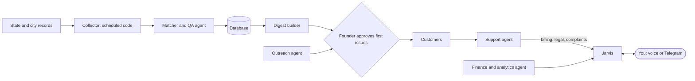

> **History.** This report picked FirstTab on 2026-11-08 before the founder redirected to a consumer product. Superseded by [the ReplyRate memo](../REPLYRATE_MEMO.md). Kept for its 30-idea screen.

# Investment Committee Report: Best Solo, AI-Operated Startup

Research date: 2026-11-08. Verdict: **CONDITIONAL GO, for a 30-day test only. Do not build the product yet.**

## How far to trust this report

**Evidence labels:** [V] verified external data · [C] calculated from stated inputs · [A] model assumption · [H] unvalidated hypothesis.
**Confidence:** High, Med or Low.

Limits of this research:

- It rests on 40 web searches. I read search-result summaries and did not open each page. Prices marked [V] are what a vendor or listing published, and may be out of date.
- Most market pages are vendor marketing. Independent reviews were scarce.
- Publication dates were mostly not available. Where a date is known, it is stated.
- No customer has been interviewed. **No willingness-to-pay evidence here is specific to this product.** It is all by analogy to adjacent paid products.
- Reddit searches returned very little that could be verified.
- Current Census counts of target businesses could not be retrieved, so market size is an assumption.
- Not checked: patents, GitHub implementations, a systematic search of failed startups, and individual portal terms of use.
- Each listed framework is applied to the three finalists, in compact form. The other 27 ideas were screened only.

Your brief says not to manufacture a winner. No candidate reached STRONG GO.

## 1. Main findings

1. **Cheap software has compressed the easy niches.** Search results are full of what appear to be recently built one-page competitors. EU product-safety apps on Shopify sell for about $8–25/month, nearly all with 0 reviews ([Shopify listings](https://apps.shopify.com/euready)). Tariff tools start at $19/month ([TariffCenter](https://tariffcenter.ai/pricing)). AI lowers the cost of building for everyone, so building is no longer an advantage.
2. **Raw public data is already a commodity.** Apify lists many permit and liquor-license feeds at roughly $3–50 per 1,000 records ([example](https://apify.com/rook-data-tools/new-food-service-license-leads)). What remains sellable is packaging for buyers who will never run a scraper.
3. **Content and consumer routes look worse than they did.**
   - YouTube reportedly terminated 16 channels with 35M combined subscribers in January 2026 under its inauthentic-content policy ([summary](https://thenextweb.com/news/youtube-ai-slop-crackdown-faceless-creators-collateral-damage), secondary).
   - RevenueCat's 2026 data, as reported, shows paid AI apps churning about 30% faster than non-AI apps ([study](https://www.revenuecat.com/blog/growth/ai-app-retention-study)).
   - Pew found 8% of users clicked a result when an AI summary appeared, versus 15% without ([summary](https://www.sistrix.com/blog/pew-research-ai-overviews-halve-click-through-rates/); Google disputes the method).
   - Google's scaled-content policy also targets templated AI pages.
4. **The typical solo outcome is small.** One sample of 30 micro-SaaS companies reported a median of $145 MRR against a $4,298 mean ([source](https://flowjam.com/blog/27-micro-saas-examples-that-actually-print-money-in-2025), Low: small sample, unaudited).
5. **"Passive" and "fast to $1M" do not hold together.** In this model, even the aggressive case takes about 7.5 years at steady state to reach $1M of cumulative pre-tax profit (section 7). A much larger outcome would need a different kind of company, with more founder work.

## 2. Thirty opportunities screened

"Searched" means it had a dedicated search this session. "Judgment" means it was screened on reasoning alone, so treat that row as weak.

| # | Opportunity | Category | Basis | Result and reason |
|---|---|---|---|---|
| 1 | Restaurant pre-opening alerts for local suppliers | Data | Searched | **Finalist.** Long-running paid precedents |
| 2 | COI tracking with AI endorsement review | Compliance | Searched | **Finalist.** Real pain, thin price room |
| 3 | Complementary-trade permit alerts | Data | Searched | **Finalist.** Clear logic, fragmented data |
| 4 | Pre-permit planning-commission alerts | Data | Searched | Top 10. WallFly, GatherGov, BoardwalkAI and Curate already active |
| 5 | Homeowner permit leads for roofers | Data | Searched | Top 10. Permit usually means a contractor is already hired |
| 6 | Low-cost grant finder for small nonprofits | Vertical | Searched | Top 5. Instrumentl from $299/month shows a gap, but buyers are cash-poor and AI entrants are active |
| 7 | Mechanics-lien deadline tracker | Compliance | Searched | Top 10. LienDeadline exists; errors can permanently forfeit rights |
| 8 | Small-business federal bid alerts | Data | Searched | Top 10. Crowded at $49–149/month |
| 9 | Tariff and HS-code tools | Compliance | Searched | Out. Crowded and accuracy-sensitive |
| 10 | GPSR/EPR Shopify app | Marketplace | Searched | Top 5. Good distribution, but $8–25 pricing and free tiers |
| 11 | Chargeback recovery | Finance | Searched | Out. Funded rivals, Stripe native tool |
| 12 | Missed-call and follow-up assistant | SMB | Searched | Out. Anecdotal demand, crowded (judgment on crowding) |
| 13 | Personalized AI stories | Consumer | Searched | Out. Retention data poor |
| 14 | Faceless AI Reels and Shorts (the current project) | Attention | Searched | Out. Policy risk; viral dependence, which your brief rejects |
| 15 | Public-data API on Apify | Developer | Searched | Out at top-10 cut. Quick first dollar, low ceiling |
| 16 | "AI automation repair" service | Service | Searched | Out. Labor-based |
| 17 | Solo Atlassian Marketplace app | Developer | Partly | Top 10. Good channel, no specific gap found |
| 18 | AI-assisted books on KDP | Content | Judgment | Out. Search returned no policy data; saturated |
| 19 | Etsy printables | Content | Judgment | Out. Saturated |
| 20 | Property-tax appeal automation | Finance | Judgment | Out. Licensing varies by state |
| 21 | Data-broker removal | Consumer | Judgment | Out. Established rivals |
| 22 | Review-response tool | Marketing | Judgment | Out. Commodity |
| 23 | Website accessibility monitoring | Compliance | Judgment | Out. Liability, crowded |
| 24 | DOT and trucking filings | Compliance | Judgment | Out. Regulated and reputationally poor market |
| 25 | Probate and pre-foreclosure lists | Data | Judgment | Out. Ethically poor, targets people in distress |
| 26 | SOC 2 preparation | Compliance | Judgment | Out. Funded rivals, sales-heavy |
| 27 | Niche paid regulatory digests | Information | Judgment | Out at top-10 cut. Low cost, weak retention assumed |
| 28 | AI bookkeeping cleanup | Finance | Judgment | Out. Accountability and support load |
| 29 | Language-learning content | Education | Judgment | Out. Dominant incumbents |
| 30 | Local-business SEO pages | Marketing | Judgment | Out. Policy risk |

**Top 10:** 1, 2, 3, 4, 5, 6, 7, 8, 10, 17.
**Top 5:** 1, 2, 3, 6, 10. **Top 3:** 1, 2, 3.

## 3. Finalist scoring

Scores are my judgment from the evidence above, not measurements.

| Factor (weight) | A: Restaurant pre-opening alerts | B: COI tracker | C: Complementary-trade permits |
|---|---:|---:|---:|
| Demand (15) | 9 | 11 | 7 |
| Willingness to pay (15) | 10 | 11 | 8 |
| Differentiation (10) | 4 | 2 | 5 |
| Unit economics (15) | 10 | 7 | 9 |
| Solo feasibility (10) | 8 | 5 | 5 |
| AI automation (10) | 6 | 8 | 7 |
| Acquisition (10) | 6 | 5 | 5 |
| Cost (5) | 4 | 2 | 3 |
| Timing (5) | 3 | 3 | 3 |
| Defensibility (5) | 1 | 3 | 2 |
| **Total** | **61** | **57** | **54** |

Evidence behind the main scores:

- **A leads on feasibility, not on excellence.** There are years of paid precedent, a low cost of being wrong, and data at state level. Automation scores only 6 because most of the work is ordinary data engineering. AI adds matching and cleanup, which is why this is a modest structural advantage.
- **B has the clearest pain but the weakest room.** bcs publishes $0.95/vendor/month with a free 25-vendor tier ([bcs](https://www.getbcs.com/alternatives)). Certificial lists free and $49 tiers ([G2](https://www.g2.com/products/certificial/reviews)). Billy already reads endorsements. Errors carry liability, since additional-insured status depends on the policy and not the certificate ([Insurance Journal](https://www.insurancejournal.com/magazines/mag-features/2026/03/23/862422.htm)).
- **C has a real insight but the hardest data problem**, with about 20,000 permit-issuing places in the US ([Census](https://www.census.gov/construction/bps/methodology.html)) [V, High].

A 61 is a passing grade for a test. It is not evidence of a strong business.

### Compact framework view

| Framework | A: Restaurant alerts | B: COI tracker | C: Permit alerts |
|---|---|---|---|
| Rivalry | Medium, fragmented | High | Medium-high |
| New entrants | High | High | High |
| Substitutes | Drive-bys, broker networks, Apify feeds | Spreadsheets, free tiers | Dodge, ConstructConnect, Construction Monitor |
| Buyer power | Medium, can cancel | High, cheap options | Medium |
| Supplier power | Low, public data, but portals can change | Low | Low, portal risk |
| VRIO | Value yes; rare no; imitable yes; no moat today | Value yes; rare no | Value yes; rare no |
| SWOT strength | Cheap to run | Sticky record | High job value |
| SWOT weakness | Timing and coverage unproven | Liability | Coverage |
| SWOT opportunity | Vendor outcome feedback | Viral vendor emails | Unserved small trades |
| SWOT threat | A rival adds packaging | Price war | Portal blocking |
| PESTLE | State public-records reuse rules; email law | Insurance and contract law | Public-records limits; marketing law |
| Job to be done | "Reach a new restaurant before its vendors are chosen" | "Prove every vendor is covered without chasing them" | "Find work created by someone else's project" |
| Blue ocean move | Local single-trade packaging; drop national data | Weak | Sell to complementary trades |
| Network effect | None. Outcome data is a learning effect at best | Weak: vendors receive emails | None |
| Smallest test | Hand-made digest, one state | Manual COI audit | Hand-made digest, one trade |
| Best business model | Subscription | Per-vendor subscription | Subscription |

Other models were considered and rejected: advertising and affiliate income need audience scale; usage pricing is unfamiliar to these buyers and makes revenue less predictable.

## 4. Competitor matrix (finalist A)

Funding and maturity could not be verified for any of these. Threat and opportunity columns are my judgment.

| Product | Customer | Pricing [V unless noted] | Model | Strength | Weakness | Complaints | Threat | Opening |
|---|---|---|---|---|---|---|---|---|
| [Starfleet Pre-Opening Resource](https://starfleetmedia.com/solutions/preopening-restaurants-resource/) | Restaurant vendors | "Under $200/mo" (2021, likely outdated) | Subscription | National, long-running | Not local or trade-specific | None found | High | Local matching |
| [Restaurant Activity Report](https://restauranttechnologynews.com/rtn-partner-restaurant-activity-report/) | Tech vendors | Not found | Subscription | 4x weekly | Pricing unclear | None found | High | Local packaging |
| [Flhip](https://www.restaurantmagazine.com/flhip-finds-hundreds-of-new-restaurants-opening-weekly) | Vendors | Not found | Unclear | Hundreds weekly claimed | Current status unverified | None found | Medium | Check if active |
| RestoSignals (URL not isolated) | Vendors | Not found | Feed | Pre-opening focus | Limited states | None found | High | Unknown |
| [NYC dataset](https://csvfirst.pythonanywhere.com/csv/nyc-newly-licensed-restaurant-dataset/) | Vendors | $999/mo | Subscription | Daily | One city, unverified seller | None found | Low | Price |
| [Chain Store Guide](https://chainstoreguide.com/category/restaurant-franchisee-leads) | Enterprise | $1,800/yr franchisee plan | Database | Established | Chains, not new independents | None found | Low | Independents |
| [Apify feeds](https://apify.com/rook-data-tools/new-liquor-license-leads) | Technical buyers | About $5–50 per 1,000 | Pay per record | Very cheap | Needs technical setup | None found | Medium | Non-technical buyers |

**Why it may remain underserved [H, Low]:** coverage is fragmented by state, and each local vendor is a small account. That makes it unattractive for a staffed sales team, but workable for an automated operator. This may instead mean the market is simply small. The test in section 11 is designed to tell these apart.

## 5. Why anyone would pay

**Need:** winning a new account before a competitor does. For a local vendor, an account is recurring income.

**Mechanism:** status quo bias. Once a restaurant has picked a POS or service vendor, inertia favors that vendor. Samuelson and Zeckhauser (1988) documented the bias ([paper](https://scholar.harvard.edu/files/rzeckhauser/files/status_quo_bias_in_decision_making.pdf)), and a pre-registered replication supported it in three of four scenarios ([Xiao et al., 2021](https://doi.org/10.15626/mp.2020.2470)). Those studies used individual decisions. **Applying them to restaurant vendor choice is my inference.**

Loss aversion is plausible as a reason vendors fear missing openings. The usual citation is Tversky and Kahneman (1991), which I could not confirm through search, so it should be checked before reuse.

**Speed matters only directionally.** Popular "respond in five minutes" numbers trace to a Harvard Business Review practitioner article and vendor data. I found no peer-reviewed study.

**Neuroscience:** dopamine, variable rewards and curiosity gaps explain nothing useful here. This is a business tool, and engagement design would add no value. I have left them out deliberately.

| Question | Answer |
|---|---|
| Observable behavior | Paid lead products have existed for years [V] |
| Willingness to pay | Adjacent prices only; nothing for this product [H] |
| Why return | Each week brings new openings; a won account justifies many months |
| Why leave | Leads arrive too late, too few in the area, or a seasonal lull |

## 6. Recommended business (test candidate)

- **Working name:** FirstTab (availability not checked).
- **Description:** a weekly alert of restaurants about to open, filtered to one service area and one trade.
- **Exact customer:** owner-operated POS dealers and kitchen-service vendors with 1–20 staff in Texas [H].
- **Why Texas first:** search results indicate state open-data sources and existing Texas liquor-license feeds. Confirm coverage before anything else.
- **Why now:** cheap LLMs make it practical to clean and match messy records for one small account.
- **Honest differentiation:** narrow local packaging. It is copyable.
- **MVP:** weekly email with business name, address, license stage and date, plus an unsubscribe. A web app is not needed.
- **Avoid at first:** dashboards, CRM, a phone-number database, mobile apps, national coverage, homeowner or consumer data.
- **Price:** $79/month per service area, with a $0 sample issue [A].

Liquor licenses miss restaurants that do not serve alcohol. Health-permit data is local and may lag; one vendor cites about 3 months for some city data, by which point vendors have probably been chosen. **Timing is the assumption most likely to kill this.**

## 7. Financial model

All results are [C] from the inputs below. Inputs are [A] unless noted.

### Costs

| Item | Monthly | Label | Note |
|---|---:|---|---|
| Domain | $1 | A | About $12/year |
| Hosting and database | $0 | A | Cloudflare free tier exists ([limits](https://developers.cloudflare.com/workers/platform/limits)); fit unproven |
| LLM, one metro | $1.05 | C | 200 records/day, 2,000 in and 300 out tokens, [Haiku 5.5 batch](https://platform.claude.com/docs/en/about-claude/pricing) at $0.05/$0.25 per MTok [V] |
| Postal mailbox | $15 | A | CAN-SPAM needs a valid physical address |
| One sending mailbox | $7 | A | |
| **Stage 0, validation** | **about $26** | A | Within your $50 cap, rounded up for the LLM line |
| Added outbound tool, second mailbox, verification | $53 | A | Stage 1 total about $79. **Over your $50 cap**, justified only after a first payment |
| Tech E&O | $91 | V | [Insureon SaaS average](https://insureon.com/technology-business-insurance/saas-companies/cost); not a quote. Stage 2 total about $170 |

One-off: domain about $12, plus an LLC, whose cost varies by state and may alone exceed your $100 budget. Ask a local accountant or lawyer whether to form one before first revenue.

### Unit economics at $79/month

| Metric | Calculation | Result |
|---|---|---:|
| Stripe processing | 2.9% × 79 + $0.30 ([Stripe](https://stripe.com/pricing)) | $2.59 |
| Stripe Billing | 0.7% × 79 (sources conflict; help center used) | $0.55 |
| AI and support per customer | Assumption | $0.50 |
| Contribution margin | 79 − 3.64 | **$75.36 (95.4%)** |
| Break-even, Stage 1 | 79 ÷ 75.36 | 2 customers |
| Break-even, Stage 2 | 170 ÷ 75.36 | 3 customers |

### Scenarios

Your table's "monthly visitors" is replaced by outbound emails, because this model has no website traffic. Reply-rate reports span 1.4–3.7% ([Instantly](https://instantly.ai/cold-email-benchmark-report-2026), [Saleshandy](https://saleshandy.com/blog/cold-email-statistics/), [Boomerang](https://www.getboomerang.ai/glossaries/cold-email-reply-rate-benchmarks-2026)), with positive replies of 0.3–0.6% in one source, Low confidence. SMB churn is commonly reported at 3–7% monthly, and a lead product may be worse.

| Metric | Conservative | Base | Aggressive |
|---|---:|---:|---:|
| Emails per month | 1,000 | 2,000 | 4,000 |
| Positive reply rate | 0.3% | 0.5% | 0.6% |
| Positive reply to paid | 10% | 20% | 25% |
| Email-to-customer conversion | 0.03% | 0.10% | 0.15% |
| New customers per month | 0.3 | 2.0 | 6.0 |
| Monthly churn | 8% | 6% | 4% |
| Steady-state customers | 3.8 | 33 | 150 |
| Steady-state MRR | $296 | $2,633 | $11,850 |
| Steady-state ARR | $3,555 | $31,600 | $142,200 |
| LTV (75.36 ÷ churn) | $942 | $1,256 | $1,884 |
| Steady-state monthly profit | $204 | $2,342 | $11,119 |
| Net margin at steady state | 69% | 89% | 94% |

| Month | Conservative customers / revenue / profit | Base | Aggressive |
|---|---|---|---|
| 1 | 0 / $0 / −$26 | 0 / $0 / −$26 | 0 / $0 / −$26 |
| 3 | 0.6 / $46 / $17 | 3.9 / $307 / $213 | 11.8 / $929 / $702 |
| 6 | 1.3 / $101 / $17 | 8.9 / $701 / $498 | 27.7 / $2,188 / $1,903 |
| 12 | 2.3 / $178 / $91 | 16.5 / $1,300 / $1,070 | 54.3 / $4,287 / $3,905 |
| 24 (Year 2) | 3.2 / $253 / $162 | 25.3 / $1,999 / $1,737 | 91.3 / $7,216 / $6,699 |
| 36 (Year 3) | 3.5 / $280 / $188 | 29.5 / $2,331 / $2,054 | 114.1 / $9,011 / $8,411 |
| Cumulative 36-month profit | $4,184 | $47,282 | $182,871 |

**First dollar:** month 2 to 5 in the model [A]. Real timing depends on the test in section 11. Profit excludes tax and your time.

**Do not use the LTV/CAC ratio.** Using cash cost alone, the model gives 4.6:1, 41:1 and 150:1. Your brief rightly warns against ratios like these. They are inflated because founder time and failed experiments are excluded, and because the conversion inputs are guesses.

**Prospect supply is a hidden limit.** Base needs about 8,000 new prospects a year at three emails each, far more than one state's POS and kitchen vendors are likely to supply. The Base case therefore requires other trades or states.

### Sensitivity (Base, steady state)

| Change | Customers | MRR | Monthly profit |
|---|---:|---:|---:|
| Base | 33 | $2,633 | $2,342 |
| CAC doubles (outbound cost +$61) | 33 | $2,633 | $2,281 |
| Conversion −50% | 17 | $1,317 | $1,086 |
| Churn doubles to 12% | 17 | $1,317 | $1,086 |
| AI costs +100% | 33 | $2,633 | $2,317 |
| Price falls to $59 | 33 | $1,967 | $1,699 |
| Prospects −50% | 17 | $1,317 | $1,086 |
| Rival enters (conversion −30%, $59, 8% churn) | 18 | $1,032 | $811 |

AI cost barely matters. **Churn, conversion and prospect supply decide the outcome.** Churn above about 15% with weak conversion leaves a hobby income.

### Path to $1M

| Route | Requirement |
|---|---|
| $1M pre-tax profit in 5 years at steady state | About 223 customers, $17,651 MRR [C] |
| Aggressive case at steady state | 7.5 years |
| Base case at steady state | 35.6 years |

This business alone is unlikely to deliver your millionaire goal quickly. It is better viewed as a low-risk first asset producing perhaps a few thousand dollars a month if it works.

## 8. AI operating model

Only five roles are justified at this size. The collector should be ordinary code, because an LLM there would add cost and error.

| Agent | Inputs → outputs | Tools and memory | Authority | Escalate when | Cost | Recovery |
|---|---|---|---|---|---|---|
| Collector (not AI) | Portals → raw rows | Cron, Python, source log | Fetch only | Source count drops or format changes | About $0 | Retry, then hold the issue |
| Matcher/QA | Rows → deduped, classified leads | Haiku batch, past records | Reject low-confidence rows | Confidence low or volume unusual | About $1/metro/month [C] | Exclude row, flag it |
| Outreach | Vendor lists → drafts | Email tool, suppression list | Drafts only until policy changes | Any complaint | Under $1 [A] | Stop sequence |
| Support | Tickets → answers | Help docs, ticket history | Answer FAQs | Refunds, legal, anger, data requests | Under $1 [A] | Hand to you |
| Finance/analytics via Jarvis | Stripe, usage → briefing | Read-only keys, ledger | Report only | Budget or churn thresholds | Under $1 [A] | Use the last good report |

**Handoffs:** Collector → Matcher → Digest → founder approval → customer. Support and Finance report to Jarvis, which is your single interface.

**Reuse from the archive:** n8n, Postgres and the MCP layer may help Jarvis. Voice input (JAR-02) was never built. Production jobs should run in the cloud, because the laptop stack depends on the machine being on and awake (KI-1).

### What actually needs you

| Task | Technically automatable | Operationally automatable | Needs human oversight | Not worth automating |
|---|:--:|:--:|:--:|:--:|
| Data collection and digests | Yes | Yes | | |
| Support FAQs | Yes | Yes | | |
| Reporting | Yes | Yes | | |
| Outreach drafting | Yes | Yes | Approval | |
| Sending to new segments | Yes | Partly | Approval | |
| Complaints and refunds | Partly | Partly | Yes | |
| Portal breakage | Partly | Partly | | Often |
| Legal entity, tax, contracts | | | **Yes** | |
| Spending, account connections | | | **Yes** | |
| Security incidents | Partly | | **Yes** | |
| Pricing and strategy | | | **Yes** | |

**Estimated automation:** 75–85% of recurring task volume [H]. Expect 15–25 hours a week for the first three months, then perhaps 2–4 hours a week if it stabilizes [A]. No public persona is needed, but Stripe needs your legal identity and each commercial email needs a postal address.

## 9. Distribution

| Channel | Fit | Cost | Time to results | CAC | Automation | Main risk |
|---|---|---|---|---|---|---|
| **Personal, low-volume B2B email with a real local sample** | **Best** | Low | Weeks | [C] Unknown until tested | High, with approvals | Deliverability, spam complaints |
| Trade associations and partners | Good | Low | Months | Unknown | Low | Slow |
| Directory listings | Moderate | Low | Months | Low | Medium | Weak intent |
| Referrals | Moderate | Low | After customers | Low | Medium | Small |
| Programmatic SEO | Weak now | Low | 6+ months | Unknown | High | Google policy, AI summaries |
| Reddit, Product Hunt | Poor | Low | Fast | Unknown | Low | Wrong audience |
| Reels, Shorts, TikTok | Poor | Medium | Uncertain | Unknown | High | Wrong audience, viral dependence |
| Paid ads | Not yet | High | Fast | Unknown | Medium | Burns budget |

**Email rules:** CAN-SPAM has no B2B exemption, and penalties reach $53,088 per violating email ([secondary](https://prospeo.io/s/can-spam-penalties); confirm with the FTC). Each email needs truthful headers, a postal address and a working opt-out. Google advises keeping spam rates under 0.1%, with 0.3% as the limit. Email only businesses, send low volumes, and never buy dubious lists.

| Milestone | Route |
|---|---|
| First 10 customers | Hand-approved outreach with a real sample for their area |
| First 100 | Add trades and states, referrals and association partnerships |
| First $1,000 total revenue | About 13 customer-months at $79 [C] |
| $5,000 MRR | About 64 customers [C]. Beyond Base; needs expansion |

## 10. Legal and platform risks

Not legal advice. Have a lawyer review before charging customers.

| Risk | Severity | Note |
|---|---|---|
| Portal terms and public-records reuse | **Could stop the business** | Not researched per portal. Prefer official open-data feeds; a 2020 South Carolina bill shows some states have considered limits on permit data (enactment unconfirmed) |
| Email law and deliverability | High | Above |
| Inaccurate data | Medium | Disclaimers, E&O after revenue |
| Personal data in filings | Medium | Business contacts only; avoid owner home addresses and phone numbers; TCPA not researched |
| Stripe or email account closure | Medium | Keep complaint rates low |
| AI disclosure | Low | Disclose automated compilation |

## 11. Validation before building

Stated interest does not count. Only payment does.

| | A: Restaurant alerts | B: COI tracker | C: Permit alerts |
|---|---|---|---|
| Hypothesis | Vendors pay $79 for local alerts early enough to matter | Small GCs pay for chasing and endorsement checks | Complementary trades pay for permit signals |
| Method | Build 4 hand-made digests from public data, then sell | Manual audit of 25 COIs | Hand-made digest for one trade, one metro |
| Cost | Under $30 | Under $30 | Under $30 |
| Duration | 4 weeks | 4 weeks | 4 weeks |
| Sample | 100 vendors contacted, 10 interviews | 100 GCs, 10 interviews | 100 firms, 10 interviews |
| **Success** | **3+ prepaid at $79, and 50%+ of leads pre-date vendor selection** | 3+ prepaid audits at $99 | 3+ prepaid at $99 |
| **Failure** | **0 payments, or most leads already have vendors** | Buyers choose free tiers | Under 2 payments, or poor coverage |
| Next action | Pass: build minimal pipeline. Fail: test B | Pass: compare with A | Pass: compare with A |

Run A first. Test timing before price, since a late lead is worthless at any price.

## 12. Top risks

Probability and impact are judgment.

| # | Risk | Probability | Impact | Mitigation | Kill signal |
|---|---|---|---|---|---|
| 1 | Leads arrive too late | High | Fatal | Test with 10 vendors first | Most have vendors chosen |
| 2 | No one pays | Medium-high | Fatal | Prepayment test | 0 of 100 contacted |
| 3 | Market too small | Medium-high | High | Count Texas vendors early | Under 500 reachable vendors statewide |
| 4 | Commoditized by a rival | High | High | Stay local and trade-specific | Sustained price below $40 |
| 5 | High churn | Medium-high | High | Measure wins per customer | Over 15% monthly after month 3 |
| 6 | Data access lost | Medium | High | Official feeds, several sources | Core source closed |
| 7 | Email reputation damage | Medium | High | Low volume, opt-outs | Spam rate over 0.3% |
| 8 | Founder time exceeds plan | High | Medium | Stop-loss | Over 10 hours/week after month 6 |
| 9 | Legal complaint | Low | High | Lawyer review, business data only | Any demand letter pauses sending |
| 10 | Budget above target | High | Low | Stage costs by revenue | Spend above revenue after month 6 |

## 13. 30-day plan

No product code in this period.

| Week | Deliverable | Cost | Agent | Success metric | Done when |
|---|---|---:|---|---|---|
| 1 | Confirm Texas sources; legal check of terms; count vendors | $0–12 | Research | Usable official source and 500+ vendors | Written go/stop note |
| 2 | Two hand-made digests; interview 10 vendors about when they get chosen | $7 | Research, QA | 50%+ of sampled leads pre-date vendor choice | Interview notes logged |
| 3 | Founder-approved outreach to 100 vendors with a local sample | $15 | Outreach | 3+ serious conversations | All 100 logged |
| 4 | Prepayment offer; decision meeting | Stripe fees | Finance, Jarvis | 3+ prepaid | Written decision |

**Kill rule:** after week 4, 0–1 payments means stop and test finalist B. Do not build in hope.

## 14. Final verdict: CONDITIONAL GO

**Go for the 30-day test only.** It costs under $100 and answers the questions that desk research cannot.

**Not a GO to build.** Demand for this exact offer is unproven, differentiation is thin, there is no moat yet, and market size is unmeasured.

**Conditions to proceed:** at least 3 prepaid customers, at least 50% of leads ahead of vendor selection, at least 500 reachable vendors, and a lawyer's sign-off on data reuse and email practice.

**If it passes:** a plausible outcome is $1,000–$3,000 profit a month within two to three years, with a few hours of oversight per week [H]. That is worthwhile, but it isn't a fast route to millionaire status.

Sources are linked inline. Research date for all: 2026-11-08.
